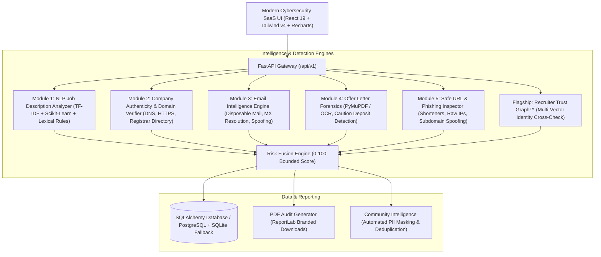

# JOBTRUST 🛡️
## AI-Powered Recruitment Fraud Detection and Trust Verification Platform
**Built for the Vedathon Open Innovation Hackathon**

[](https://www.python.org/)
[](https://fastapi.tiangolo.com/)
[](https://react.dev/)
[](https://tailwindcss.com/)
[](https://scikit-learn.org/)
[](LICENSE)

---

### 1. Executive Summary

Every year, millions of students and junior job seekers fall victim to fraudulent recruitment schemes: advance registration fees, fake placement drives, lookalike corporate domains, spoofed HR emails, and manipulated appointment letters.

**JOBTRUST** is an explainable AI and cybersecurity intelligence SaaS platform. Rather than issuing arbitrary or opaque verdicts, JOBTRUST breaks down recruitment opportunities across multiple independent forensic dimensions to compute a transparent **0 to 100 Risk Assessment Score** backed by concrete evidence and actionable guidance.

---

### 2. System Architecture



---

### 3. Core Modules & Innovations

#### 🧠 Module 1: NLP Job Description Analyzer
- **TF-IDF + Scikit-Learn Classifier**: Trained on evaluated recruitment datasets to generate statistical fraud probabilities.
- **Rule-Based Heuristic Scanners**: Detects mandatory advance registration fees, refundable equipment caution money, guaranteed selection without interviews, urgency pressure tactics ("offer expires in 2 hours"), and copy-paste earning patterns.
- **Entity Extraction**: Automatically isolates company name, role, salary, fee demands, and communication channels.

#### 🌐 Module 2: Company Authenticity & Domain Verifier
- **Corporate Registrar Cross-Audit**: Validates company identity against verified enterprise records (Fortune 500, NASSCOM, Global Registries).
- **Homoglyph & Typosquatting Detection**: Normalizes confusion characters (`0` $\leftrightarrow$ `o`, `1` $\leftrightarrow$ `l`, `rn` $\leftrightarrow$ `m`) and detects brand spoofing (e.g. `micros0ft-careers.com`).
- **Network Resolution**: Validates HTTPS transport encryption and queries DNS A / MX records.

#### ✉️ Module 3: Email Intelligence Engine
- Identifies disposable/temporary inbox providers (`mailinator`, `tempmail`, `guerrillamail`).
- Detects corporate impersonation when public webmail (`@gmail.com`, `@yahoo.com`) is used to represent verified multinational corporations.

#### 📄 Module 4: Offer Letter Forensics (OCR & PDF Analysis)
- Extracts candidate name, company issuer, CTC, joining date, HR contact email, and offer reference serial numbers.
- Uncovers deceptive equipment deposit clauses (e.g. "Candidate must pay ₹15,000 laptop caution deposit before dispatch").
- Analyzes document structural metadata for consumer editing tools.

#### 🔗 Module 5: Safe URL & Phishing Inspector
- Inspects destination architecture without following uncontrolled redirects.
- Identifies URL shorteners (`bit.ly`, `tinyurl.com`), raw IP destinations (`http://192.168.1.1`), excessive subdomains, and credential-harvesting paths (`/login`, `/kyc`, `/deposit`).
- Supports Google Safe Browsing API v4 with a fallback to local heuristics.

#### 🕸️ SPECIAL INNOVATION: Recruiter Trust Graph™
- **Visual Identity Vector Mapping**: Constructs an interactive graph comparing:
  1. Claimed Corporate Entity
  2. Official Registrar Domain
  3. Recruiter Sender Email Domain
  4. Web Application Portal Domain
- Dissects spoofed identity vectors (e.g., Claiming to be "Microsoft" while emailing from `@gmail.com` with portal `micros0ft-careers-portal.site`).

#### 📊 Module 6: Risk Fusion Engine
- Transparent, explainable 0–100 score:
  - `0–29`: **Lower observed risk** (Green)
  - `30–59`: **Moderate risk indicators** (Amber)
  - `60–79`: **High risk indicators** (Orange)
  - `80–100`: **Very high risk indicators** (Red)
- Generates defensive next steps (e.g., verifying via official career portal, never transferring funds).

#### 🖨️ Downloadable PDF Security Audits
- Generates professional cybersecurity audit PDFs with ReportLab featuring audit IDs, evidence tables, risk categories, and legal disclaimers.

#### 👥 Privacy-Preserving Community Scam Alerts
- Allows students to report active scams with duplicate detection and **automatic PII masking** for personal phone numbers and email addresses.

---

### 4. Interactive Live Demo Benchmarks (Vedathon)

JOBTRUST includes 3 synthetic demo benchmarks accessible via 1-click on all scanning pages:

1. **Scenario 1: Legitimate Engineering Internship (TCS)**
   - Verified enterprise domain (`tcs.com`), formal assessment stages, explicit zero-fee policy.
   - *Result*: Low Risk Score (~0–15/100, Green).

2. **Scenario 2: Advance-Fee Internship Scam (Apex Global)**
   - Guaranteed job without interview, ₹1,999 registration fee on PhonePe, WhatsApp hiring, urgency pressure.
   - *Result*: Very High Risk Score (~85–95/100, Red).

3. **Scenario 3: Corporate Brand Impersonation Attack (Microsoft Spoof)**
   - Claimed Microsoft identity, lookalike domain (`micros0ft-careers-portal.site`), HR email via `@gmail.com`, ₹12,500 laptop deposit.
   - *Result*: High-Confidence Impersonation on Recruiter Trust Graph™ (~90–100/100, Red).

---

### 5. Technology Stack

| Layer | Technologies |
|---|---|
| **Frontend** | React 19, Vite 8, Tailwind CSS v4, React Router 7, Axios, Lucide React, Recharts |
| **Backend** | Python 3.10+, FastAPI, Uvicorn, Pydantic v2, SQLAlchemy 2.0 |
| **AI / NLP** | Scikit-Learn (TF-IDF + Logistic Regression), Regex Pattern Heuristics, N-Grams |
| **Cybersecurity** | `tldextract`, `dnspython`, Google Safe Browsing API interface, Typosquatting Matcher |
| **Document OCR** | PyMuPDF (`fitz`), Pillow, PyPDF |
| **Reporting** | ReportLab PDF Engine |
| **Database** | SQLite (Default zero-config local) / PostgreSQL (Production supported) |

---

### 6. Local Setup and Installation

#### Prerequisites
- Python 3.10+
- Node.js v18+ and npm

#### A. Backend Setup
```bash
# Navigate to backend directory
cd jobtrust/backend

# Create virtual environment (optional but recommended)
python -m venv venv
# Windows:
venv\Scripts\activate
# Linux/macOS:
source venv/bin/activate

# Install dependencies
pip install -r requirements.txt

# Run backend development server
uvicorn app.main:app --host 127.0.0.1 --port 8000 --reload
```
The FastAPI backend will start at: `http://127.0.0.1:8000`
- Interactive API Docs: `http://127.0.0.1:8000/docs`
- Health Check: `http://127.0.0.1:8000/api/health`

#### B. Frontend Setup
```bash
# Open a new terminal and navigate to frontend directory
cd jobtrust/frontend

# Install dependencies
npm install

# Start Vite development server
npm run dev
```
The React application will be accessible at: `http://localhost:5173`

---

### 7. API Endpoints Reference

| Method | Endpoint | Description |
|---|---|---|
| `GET` | `/api/health` | Health & AI engine status |
| `POST` | `/api/analyze/job` | Paste & analyze job description |
| `POST` | `/api/analyze/company` | Check company authenticity & lookalike domains |
| `POST` | `/api/analyze/email` | Verify recruiter email address & MX records |
| `POST` | `/api/analyze/url` | Inspect recruitment link for phishing indicators |
| `POST` | `/api/analyze/offer-letter` | Upload PDF/image offer letter for OCR forensics |
| `POST` | `/api/analyze/trust-graph` | Generate interactive Recruiter Trust Graph |
| `GET` | `/api/dashboard/stats` | Aggregated threat analytics & metrics |
| `GET` | `/api/scans/history` | List historical verification scans |
| `GET` | `/api/scans/{id}` | Detailed scan results & recommendations |
| `POST` | `/api/reports/submit` | Submit crowdsourced scam alert (PII masked) |
| `GET` | `/api/reports/community` | List approved community scam alerts |
| `GET` | `/api/reports/{id}/pdf` | Generate & download branded PDF audit report |
| `GET` | `/api/demo/scenarios` | Retrieve synthetic demonstration scenarios |

---

### 8. Testing Suite

To run the complete automated 14-point end-to-end integration test suite:
```bash
cd jobtrust/backend
python test_all_endpoints.py
```
This validates:
- API health and demo scenarios
- Scam vs. legitimate job description analysis
- Homoglyph and lookalike domain detection
- Email infrastructure inspection
- Safe URL analysis
- Recruiter Trust Graph generation
- Offer letter OCR fee extraction
- PDF report generation
- Community report submission with duplicate rejection and PII masking

---

### 9. Legal & Ethical Disclaimer

JOBTRUST provides automated probabilistic risk intelligence and anomaly detection. Results do not constitute definitive legal accusations of fraud. Job seekers are encouraged to independently verify all employment opportunities through official corporate channels.
